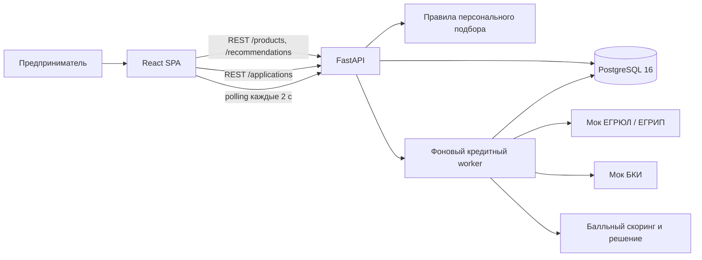
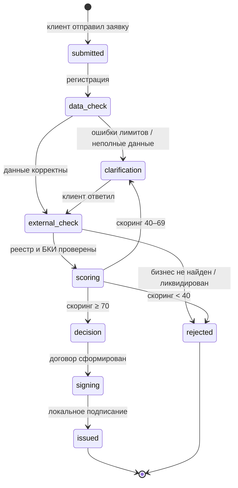
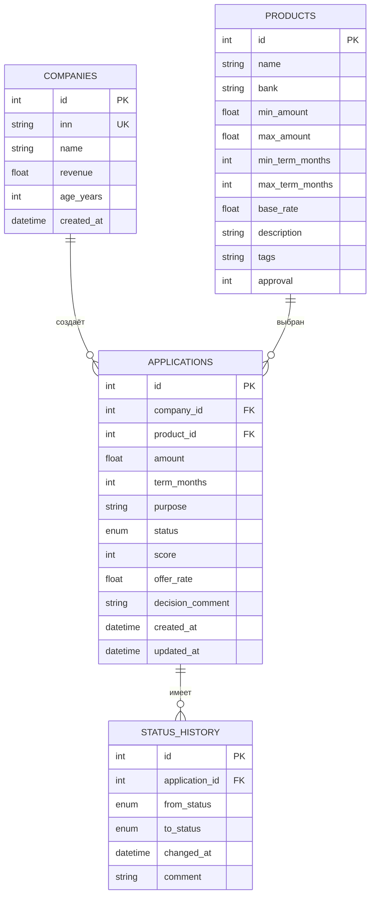

# Архитектура и модель процесса

## Компоненты

В production-контейнере FastAPI также отдаёт собранный SPA. В режиме разработки Vite работает на `7100`, а `/api` проксируется на backend. В Docker PostgreSQL запускается до приложения благодаря healthcheck. Данные сохраняются в volume.

## Состояния заявки

Автоматические переходы выполняет worker каждые 2 секунды. `clarification` и `signing` ждут действия клиента. Каждый переход пишется в `status_history`; интерфейс показывает комментарий и время.

## Модель данных

## Логика рекомендаций и решения

Рекомендации — не LLM и не вероятность одобрения. Сначала отбрасываются продукты с неподходящими суммой или сроком. Затем базовый рейтинг продукта корректируется по отношению суммы к выручке и соответствию цели. Возвращаются до трёх предложений с объяснением.

Скоринг начинается с 50 баллов и учитывает выручку, возраст бизнеса, долю запрошенной суммы в выручке, просрочки, число кредитов и долговую нагрузку. Решение отделено от скоринга: возможны одобрение, уточнение и отказ. При одобрении рассчитывается ставка предложения.

## Надёжность и ограничения

Healthcheck проверяет соединение с БД. Worker откатывает неудачную транзакцию и продолжает работу. Для MVP используется один процесс и встроенный поток; горизонтальное масштабирование потребует отдельного worker и блокировок/очереди. Схема создаётся `create_all`; изменения существующих production-схем потребуют миграций Alembic.
